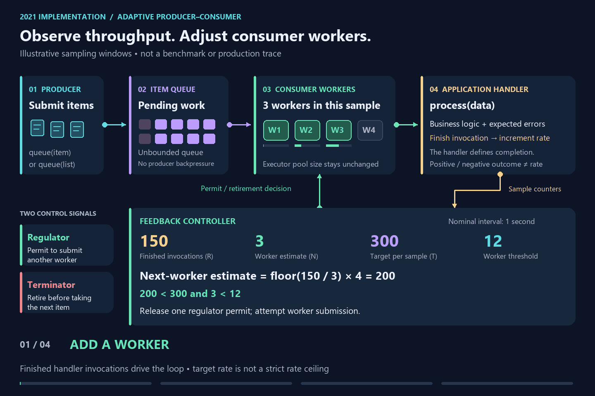

# Adaptive producer–consumer pattern

A Java exploration of adjusting consumer concurrency toward a configured target rate.

Producers enqueue items, consumers process them, and a periodic feedback loop decides whether to add or retire a consumer worker. This repository preserves the **2021 implementation**, together with an explanation of the operational experience that inspired it and what I would approach differently today.

**Project status:** historical example for study and discussion, with known limitations. It targets Java 8 and Spring Boot 2.2.3.RELEASE.

## Why I built it

The idea came from an external-service integration where I was responsible for performance enhancement. A producer read pending records from a database and submitted them for processing. The external service's response times varied considerably.

With fixed concurrency, fast responses could produce excessive throughput, while slow responses could leave us below our target. We monitored returned-response rates and manually increased thread counts when response times rose.

All returned responses counted, including negative business decisions: those submissions still consumed external capacity. A lower approval rate was not a reason to increase request pressure.

That experience prompted the question: could the application observe processing throughput and adjust concurrency automatically?

The code here is a later, enhanced exploration of that idea. It is **not the exact production implementation**, and its demonstration settings are not historical production measurements. The database producer and its record-management logic are not included in this repository.

## See the feedback loop



The animation uses illustrative samples, not benchmark data or production measurements. A [static diagram](docs/assets/adaptive-concurrency-color.png) is available as an alternative.

## How it works

The processor changes the number of submitted consumer workers. It does not resize the executor's core or maximum pool sizes.

| Component              | Responsibility                                                                  |
|------------------------|---------------------------------------------------------------------------------|
| Item queue             | An unbounded `ConcurrentLinkedQueue` holds pending items.                       |
| `queue(...)`           | Enqueues an item or list and attempts to submit a consumer worker.              |
| `regulator` semaphore  | Controls permission to submit another worker.                                   |
| Consumer worker        | Polls items and calls `Handler.process(data)` until it exits.                   |
| `rate` counter         | Counts finished handler invocations.                                            |
| `threads` counter      | Tracks the processor's estimate of submitted workers that have not exited.      |
| `regulate()`           | Samples the counters and decides whether to add a worker or request retirement. |
| `terminator` semaphore | Requests that a worker exit before taking its next item.                        |

When a worker finds the queue empty, it exits and returns a regulator permit. A controller-requested retirement exits without returning that permit, reducing the available consumer capacity.

### The control rule

The constructor asks the handler to schedule regulation with a 1,000 ms initial delay and 1,000 ms period. The supplied demonstration uses `scheduleAtFixedRate`.

For each sample:

- `R` is the number of finished handler invocations since the previous counter reset.
- `N` is the current worker-count estimate.
- `T` is the configured `maxRate`, used as the target rate.

```text
if N > 0:
    estimatedRate = floor(R / N) * (N + 1)

    if estimatedRate < T and N < maxThreads:
        release one regulator permit and attempt to submit a worker
    else if R > T and N > 1:
        request one worker retirement
    otherwise:
        leave concurrency unchanged
```

The estimate assumes an additional worker contributes roughly the current average throughput per worker. This becomes less reliable when workers compete for constrained resources.

The calculation uses integer division and compares sample counts directly with `maxRate`; it does not normalize by measured elapsed time. With regular one-second samples, the target approximates finished handler invocations per second.

**A target rate is not a rate ceiling.** This controller does not enforce a strict requests-per-second limit or guarantee minimum throughput. It also does not directly detect downstream saturation from latency or error signals.

## The handler contract

[`Handler<T>`](src/main/java/com/github/mimsic/pcp/handler/Handler.java) separates application-specific processing from the generic worker mechanism:

| Method             | Responsibility                                                                                                 |
|--------------------|----------------------------------------------------------------------------------------------------------------|
| `process(data)`    | Perform the application's processing for an item and handle expected application-specific errors and outcomes. |
| `submit(runnable)` | Submit a consumer task to the execution facility.                                                              |
| `schedule(...)`    | Arrange periodic execution of the regulator.                                                                   |
| `processor()`      | Expose the associated processor.                                                                               |

The intended contract is that expected submission errors and recovery policies belong to the application's `process(data)` implementation. The generic processor does not interpret business responses or prescribe API-specific retry behavior.

The rate counter increments in `finally` after a handler invocation finishes. A negative business decision can legitimately represent completed work. Unexpected exceptions escaping the handler are logged defensively; the worker loop can then continue. The interface permits `throws Exception`, so the intended ownership of expected error handling is a documented convention rather than a type-enforced guarantee.

**Completion must match the work being controlled.** If a handler starts an asynchronous request and immediately returns, this processor counts that return and can take another item before the request finishes. Worker count would no longer represent outstanding external requests. For this implementation, the handler must stay within the invocation until the intended unit of processing finishes. A fully asynchronous variant would need completion-aware accounting and permit ownership.

## Run the demonstration

Use **JDK 8 and Maven**. There is no Maven wrapper. The historical dependencies may require changes to build with newer JDKs.

```sh
git clone https://github.com/mimsic/mimsic-adaptive-producer-consumer-pattern.git
cd mimsic-adaptive-producer-consumer-pattern
mvn test
```

[`HandlerTest`](src/test/java/com/github/mimsic/pcp/handler/HandlerTest.java) provides the integration example:

```text
this.processor = new Processor<>(this, 12, 6, 300);
```

| Parameter         | Meaning in the 2021 implementation                                                                       |
|-------------------|----------------------------------------------------------------------------------------------------------|
| `maxThreads = 12` | Upper worker threshold checked by the regulator when adding a worker.                                    |
| `minThreads = 6`  | Initial regulator permits, not a continuously enforced minimum. Workers can exit when the queue empties. |
| `maxRate = 300`   | Sampled target rate, not a hard admission limit.                                                         |

The test enqueues 10,000 items, simulates 10–15 ms processing delays, and waits up to 120 seconds for completion. Logs report `totalThreads`, `totalRate`, and `estimatedRate`.

The existing test passed under JDK 8 during the documentation review. It demonstrates completion in this scenario; it does not establish controller stability, production performance, or correctness under every failure condition.

Executor configuration is in [`src/test/resources/application.yml`](src/test/resources/application.yml) for tests and [`config/application.yml`](config/application.yml) for the application. The executor's bounded task queue is separate from the processor's unbounded item queue.

## Scope and limitations

- **Concurrency control does not provide producer backpressure.** Producers can keep adding items while consumers are slow. The item backlog can grow without a configured capacity bound.
- **The whole pipeline is not non-blocking.** The concurrent queue uses a non-blocking algorithm, but the processor uses read/write locks and application handlers may block. The demonstration handler sleeps.
- **The controller has limited feedback.** It uses finished-invocation counts and a worker estimate. A drop in throughput can encourage additional concurrency even when a dependency is becoming congested.
- **Accounting and bounds need stronger validation.** Sampling uses `LongAdder`; submitted tasks may differ from actually running tasks. The submission-failure path decrements the worker counter even though that failed submission was not incremented. Constructor validation and concurrency-invariant tests are also absent.
- **The processor has no explicit close operation.** It does not retain the scheduled future for cancellation or expose a drain/shutdown lifecycle. Spring configuration handles executor shutdown.
- **Persistence and delivery semantics belong to the application.** Database record claiming, durable recovery, retries, and duplicate protection are outside this generic example.

These boundaries are documented while preserving the original Java implementation.

## What I would do differently today

### Separate rate, concurrency, and business outcomes

Keep the target processing rate explicit and enforce any strict external request-rate ceiling through a separate admission policy. Measure total responses, business outcomes, technical errors, and timeouts at the application boundary, alongside generic processing duration, in-flight work, and queue age.

Document precisely what a completed handler invocation represents. Do not increase external pressure simply to compensate for negative business outcomes.

### Improve measurement and control stability

Use actual elapsed sample time and avoid integer-division loss in the estimate. Measure latency directly rather than infer downstream health from throughput alone.

Consider an exponentially weighted moving average (EWMA) to smooth the signal, and distinct increase/decrease thresholds (hysteresis) to reduce oscillation. Smoothing can delay the response to genuine changes, so validate it under both bursts and sustained slowdowns.

### Add backpressure and explicit lifecycle management

Bound queued and in-flight work and define what happens when capacity is exhausted. For a database-backed producer, one option is to pause fetching further batches until capacity becomes available.

Make concurrency bounds, permit ownership, submission rejection, interruption, cancellation, and graceful shutdown explicit. Test idle periods, overload, failures, and repeated worker adjustments—not just eventual queue completion.

### Reconsider the execution model

For blocking, I/O, consider Java virtual threads while retaining explicit limits on concurrent external requests. Virtual threads do not increase downstream capacity or replace rate limiting and backpressure.

A non-blocking client is another execution option, but it still needs completion-aware concurrency control. Returning a future alone does not bound the number of outstanding requests.

### Evaluate existing implementations

[Netflix Concurrency Limits](https://github.com/Netflix/concurrency-limits) provides algorithms informed by congestion control. Its Gradient2 algorithm compares short- and long-window exponential averages of latency to identify queueing trends.

[Envoy Adaptive Concurrency](https://www.envoyproxy.io/docs/envoy/latest/configuration/http/http_filters/adaptive_concurrency_filter.html) controls HTTP requests passing through a proxy. Its gradient controller compares sampled latency with a periodically measured low-concurrency baseline to adjust outstanding-request limits.

These are useful comparisons for detecting congestion, rather than interchangeable implementations of a configured throughput target. Evaluate their objectives and integration boundaries against the workload, keeping any required request-rate ceiling explicit.

Both projects had adaptive-concurrency implementations by 2020: see [Netflix's 2018 announcement](https://netflixtechblog.com/performance-under-load-3e6fa9a60581) and [Envoy's 2020 release notes](https://www.envoyproxy.io/docs/envoy/latest/version_history/v1.14/v1.14.0). Current capabilities should not be assumed to match those historical versions.

These are retrospective design proposals, not features implemented in this repository. The 2023 experiments are outside the scope of this 2021 retrospective.

## Source map

- [`Processor.java`](src/main/java/com/github/mimsic/pcp/handler/Processor.java): item queue, worker accounting, semaphores, and control rule.
- [`Handler.java`](src/main/java/com/github/mimsic/pcp/handler/Handler.java): application processing and execution contract.
- [`HandlerTest.java`](src/test/java/com/github/mimsic/pcp/handler/HandlerTest.java): runnable demonstration.
- [`Executor configuration`](src/main/java/com/github/mimsic/pcp/config): executor construction and shutdown.
- [`pom.xml`](pom.xml): historical build and dependency configuration.

